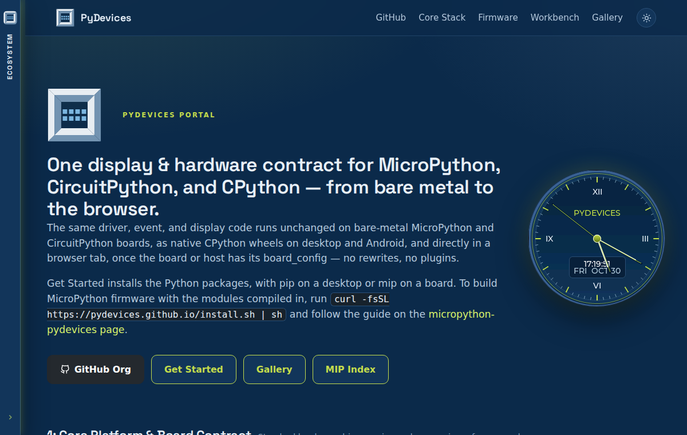

# PyDevices.github.io

The source of the PyDevices website at <https://pydevices.github.io/>: the front page, a landing page for each project, the firmware installer, and the WebAssembly MicroPython that runs the live demos. It is plain HTML, CSS and JavaScript with nothing to build.

## Install

There is nothing to install to read the site. To work on it, clone it and use Python 3's standard library to serve it:

```bash
git clone https://github.com/PyDevices/PyDevices.github.io
cd PyDevices.github.io
```

## Try it

```bash
python3 tools/serve_local.py --port 8000
```

It prints:

```
Serving the sibling checkouts at http://127.0.0.1:8000/
  /                    -> PyDevices.github.io
  /mip/                -> mip/.site + origin/gh-pages
  /gallery/            -> gallery/.site + origin/gh-pages
```

Open <http://127.0.0.1:8000/> and you get the page in the image above, with the clock running. The `/mip/` and `/gallery/` addresses work when a clone of `mip` or `gallery` sits beside this one.

[Docs](docs/index.md) | [Roadmap](ROADMAP.md) | [Contributing](CONTRIBUTING.md)

Made by [PyDevices](https://pydevices.com).
